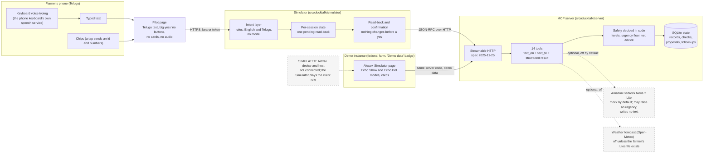
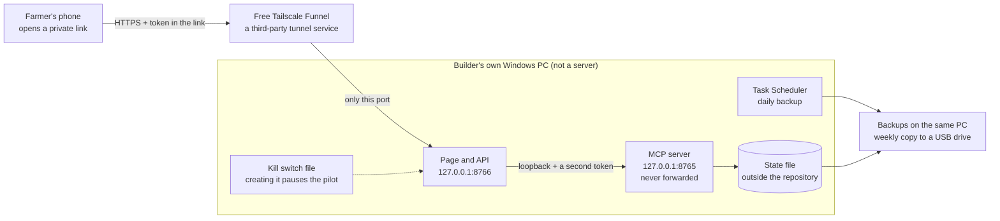

# Architecture

What is built, as it is today. The longer design, with its rules and what is planned, is `docs/DESIGN.md` (section 2 is the original sketch; sections 15 and 19 describe the Simulator and the pilot). Everything drawn with a dashed line or marked SIMULATED is **not** a real connection. Nothing here has run on an Alexa+ device.

## 1. The system

**What the boxes are.**

- **Pilot page and Simulator.** One local web app. In the pilot it serves a Telugu phone page; in the demo it serves the Alexa+ Simulator with device modes and cards. The Simulator plays the part an Alexa+ host would play, so the MCP server can be tried while no Alexa+ device can load the add-on. Its source is `src/clucktalk/simulator/`.
- **Intent layer.** Rules, not a model. It picks the tool from the farmer's words (English, Hinglish, typed Telugu) and passes the farmer's shed words through unchanged; the server resolves them. When no rule matches it says so and makes no tool call.
- **MCP server.** `src/clucktalk/server/`, Streamable HTTP, MCP 2025-11-25. 14 tools: `get_farm_status`, `plan_feed`, `plan_sale`, `get_daily_briefing`, `start_health_check`, `get_health_check`, `prepare_vet_handoff`, `report_health_follow_up`, `log_daily_record`, `get_record_book`, `get_farm_profile`, `set_farm_mode`, `set_contract_terms`, `get_help`. Tools answer from stored state and never wait for a model. Two tools, `start_health_check` and `get_daily_briefing`, hand a job to a background worker that can call the model when live AI is chosen; everything else makes no model call (design rule, `docs/DESIGN.md` section 3). State is SQLite.
- **Safety in code.** Levels, the minimum urgency of a health check, the follow-up rule and the vet advice are computed in `src/clucktalk/domain/` and `src/clucktalk/server/tools/`. See `docs/SAFETY_MATRIX.md`.

### What is real and what is simulated

| Part | Status | Detail |
|---|---|---|
| The MCP server and its 14 tools | Real code, run locally | Tested: `docs/RESULTS.md`, `docs/proof/`. Not run through Alexa+. |
| The Simulator and the Telugu pilot page | Real code, run locally; **plays the Alexa+ client role** | Not Amazon's tool and not an Alexa+ device. The page's logic is tested in Node against a hand-made DOM, not in a phone browser. |
| Alexa+ device, Alexa's own speech, Amazon's review | **SIMULATED / not done** | Nothing was loaded on an Alexa+ device. Alexa composes its own speech from a tool's result. |
| Farm data in the demo | **SIMULATED** (fictional farm) | `data/seed/demo_farm.json`, "Demo data" badge. |
| Farm data in the pilot | Real farmer's houses, entered by the builder from what the farmer said | No farmer has used the pilot yet, so usage numbers are pending (`docs/PILOT_RUNBOOK_WINDOWS.md`, `docs/CLOUD_PILOT.md`). |
| Market prices, sensors, supplier, SMS, payments, the vet message | **SIMULATED** | Labelled "Simulated" in the text and the tool descriptions. No SMS is ever sent. |
| Amazon Bedrock Nova 2 Lite | Mock by default; a few one-off live calls were made outside the server | The server's live-AI path was not verified end to end here (`docs/AWS_SETUP.md`, FL-014). |
| Weather forecast | Off by default; simulated curve in the demo | The live Open-Meteo adapter was tested only with a fake transport (`docs/SOURCES.md`). |
| Voice | The phone keyboard's own voice typing, in Telugu | No Telugu audio output exists; no Telugu voice was tested through Alexa+. |
| Telugu wording | Mostly pending | 86 of 433 strings reviewed by the builder, a native Telugu speaker; 347 pending (including the pilot page); no independent review. (`docs/TELUGU_REVIEW.md`) |

## 2. The pilot deployment (the PC pilot; the Lightsail cloud pilot since 2026-10-13 is in `docs/CLOUD_PILOT.md`)

The plan is `docs/PILOT_RUNBOOK_WINDOWS.md`; the launcher scripts are in `deploy/windows/`. **No farmer has used the pilot yet, so usage numbers are pending; the Lightsail cloud pilot with the sample farm has been deployed since 2026-10-13, and results will be added after the pilot.** This repository records no measurement of it: no usage numbers, no uptime and no speed.

### What is real and what is simulated, and the honest limits

| Part | Status | Honest limit |
|---|---|---|
| The launcher scripts and their settings | Written; tested by text checks and by the code's own settings loaders | How they behave on the pilot PC is not recorded in this repository. The Tailscale commands in the runbook are from memory of its documentation. |
| Availability | Depends on the builder's PC and its internet | If the PC sleeps, restarts or loses its connection, the farmer cannot use it. A missed scheduled backup is not caught up. Nothing about uptime or speed has been measured. |
| Who can reach it | Anyone who has the private link | A bearer token in the link, not an account or OAuth. A second, different token guards the MCP port, which is on the loopback only. A lost phone or a shared link means making a new token. |
| Security of the host | A personal Windows PC | No hardened server, no firewall review, no intrusion monitoring. Disk encryption is recommended in the runbook, not checked. |
| The farmer's data | A state file and backups on that PC and a USB drive | Not in the repository. The builder can read it. Deleting it on request is a documented step. Usage counters hold numbers only. |
| The tunnel | A free third-party service | Its terms, limits and availability are Tailscale's; they were not tested here. |
| What the farmer sees | The same prototype build as the demo, with the farmer's own houses | Not Alexa+ and not a veterinary service. Alerts are reminders from general thresholds (`docs/SAFETY_MATRIX.md`). |
